<div align="center">

# ✨ Pathfinder: HR Roadmap Copilot

### HR leaders get a people-practices report card once a year. Pathfinder makes it useful all year round.

An AI copilot that turns annual HR assessment and benchmark results into a living people strategy. It explains the gaps, builds a prioritised roadmap, tracks execution across countries, proves the business impact in euros, and pre-fills next year's assessment.

<br>

[**▶ Open the live prototype**](https://aayushm1.github.io/hr-roadmap-copilot/) &nbsp;·&nbsp; [**🎬 Start the 3-minute guided demo**](https://aayushm1.github.io/hr-roadmap-copilot/?tour=1) &nbsp;·&nbsp; [How it works (plain English)](HOW-IT-WORKS.md)

<br>


<br>

<a href="https://aayushm1.github.io/hr-roadmap-copilot/">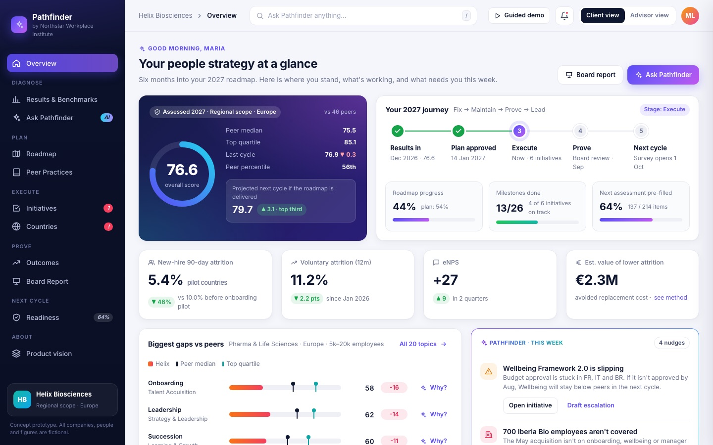</a>

</div>

> [!NOTE]
> This is an independent product concept, built as a senior-PM exercise in HR tech. **Northstar Workplace Institute** (an HR assessment and benchmarking provider), **Helix Biosciences** (the client) and every person, company and number in the prototype are fictional. It is not affiliated with or endorsed by any real company.

---

## Contents

1. [TL;DR](#tldr)
2. [The problem](#1-the-problem)
3. [Users and jobs to be done](#2-users-and-jobs-to-be-done)
4. [The solution: one continuous loop](#3-the-solution-one-continuous-loop)
5. [Product tour](#4-product-tour)
6. [Key product decisions](#5-key-product-decisions)
7. [Business model](#6-business-model)
8. [Success metrics](#7-success-metrics)
9. [Rollout plan](#8-rollout-plan)
10. [Risks and mitigations](#9-risks-and-mitigations)
11. [Try it yourself](#10-try-it-yourself)
12. [How it's built](#11-how-its-built)

---

## TL;DR

| | |
|---|---|
| **Problem** | HR assessments run as a yearly cycle: survey → audit → results PDF → nothing for 9 months. HR teams struggle to act on the insights, renewal gets harder to justify, and turning data into action needs a paid advisor for every engagement. |
| **Insight** | The assessment provider owns a unique asset: validated HR-practice data from ~2,500 organisations. What's missing is the workflow that turns it into **decisions, execution and proof** all year round. |
| **Solution** | One loop in one product: **Diagnose → Plan → Execute → Prove → Next cycle**, with an AI analyst that only answers from validated data and always cites its sources. |
| **Two-sided value** | The client improves faster and can prove it to their board. The provider gets weekly usage, churn and expansion signals, and a dataset no competitor has. |
| **North-star metric** | Monthly active client accounts **outside** assessment season |
| **Demo result** | Helix Biosciences, 6 months in: new-hire attrition **−46%** in pilot countries (**≈ €2.3M/yr**), projected score **76.6 → 79.7**, next year's survey **64% pre-filled** |

---

## 1. The problem

HR assessment and benchmarking providers evaluate a company's people practices once a year and hand back a results report. The value chain today:

```
Survey (weeks of HR effort) → Independent validation → Results report → … 9 months of silence … → Next survey
```

| Who | Pain today |
|---|---|
| **Chief People Officer** | Gets a long static report. Knows *where* they are behind peers, but not *why*, *what to do first*, or *how to prove* it worked. |
| **Country HR leads** | No shared plan. Each country interprets the results differently, and progress is tracked in spreadsheets. |
| **CFO** (the real renewal decision-maker) | Sees a yearly fee and a badge, but no measurable business outcome. |
| **The assessment provider** | Value shows up once a year, so renewals are at risk. Advisory scales only with headcount. It's blind to which clients are struggling until renewal. |

**The core insight:** the provider already holds the most valuable dataset in the industry (validated practices plus peer benchmarks). The product gap is everything that happens *after* the results arrive.

## 2. Users and jobs to be done

| User | Job to be done |
|---|---|
| **Chief People Officer** *(primary)* | "Help me set the right priorities, win board support and prove ROI." |
| **Country HR leads** | "Tell me my local gaps, what to do and how I'm tracking against the plan." |
| **HR business partners** | "Give me data-backed talking points for my business leaders." |
| **Provider advisors** | "Show me which clients need help and prepare me in minutes, not hours." |
| **Provider account managers** | "Warn me about churn early and show me where to expand." |

## 3. The solution: one continuous loop

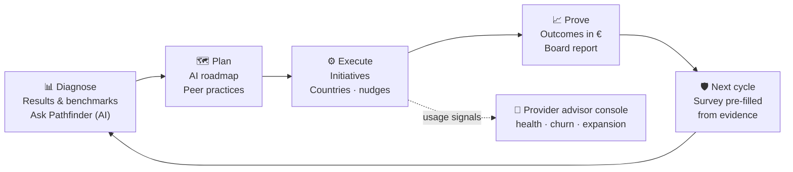

As the company matures, the same product moves with it: **Fix** (close gaps) → **Maintain** (hold standards through change) → **Prove** (show business impact) → **Lead** (be recognised as top performers). That's why clients don't "graduate" out of it.

## 4. Product tour

> The story: **Maria Lindqvist**, CPO of **Helix Biosciences** (8,400 people, 12 countries, pharma), is six months into her 2027 roadmap. Helix scores **76.6**: above the peer median of 75.5, below the top quartile of 85.1.

<table>
<tr>
<td width="50%"><a href="https://aayushm1.github.io/hr-roadmap-copilot/#/copilot">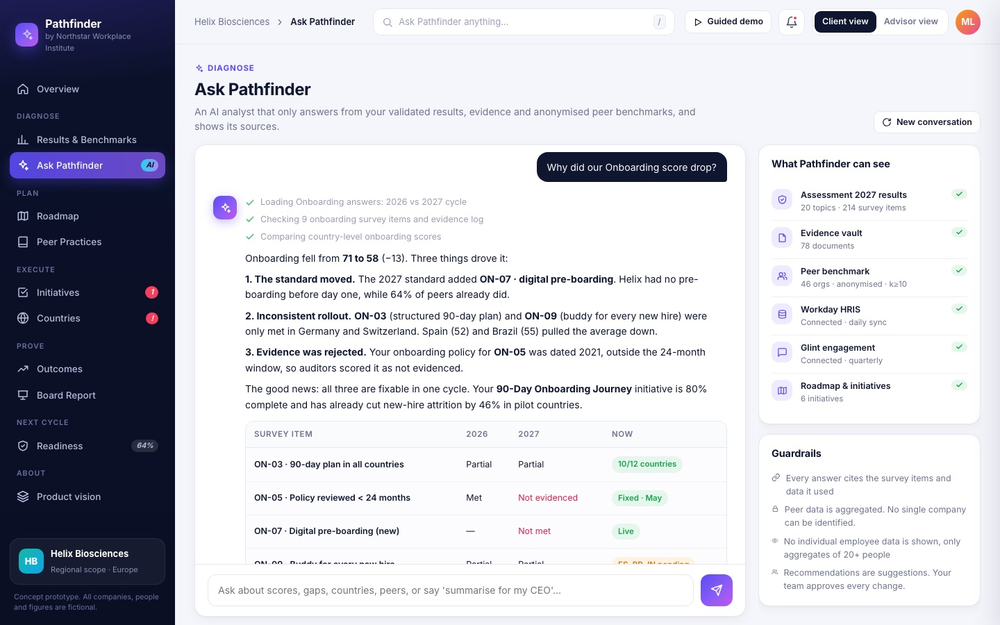</a></td>
<td width="50%"><a href="https://aayushm1.github.io/hr-roadmap-copilot/#/roadmap">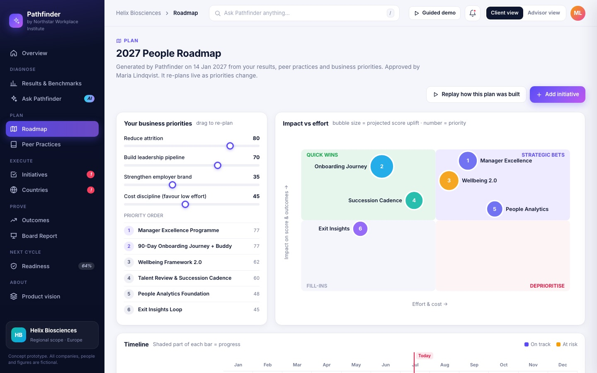</a></td>
</tr>
<tr>
<td><b>Ask Pathfinder.</b> An AI analyst that shows its reasoning steps, cites the exact survey items behind each claim, and ends with one-click actions. It traces the Onboarding drop (71 → 58) to three root causes.</td>
<td><b>AI roadmap.</b> Business-priority sliders re-rank initiatives live. Includes an impact/effort matrix, a dependency-sequenced timeline, a projected score, and a step-by-step replay of how the plan was built.</td>
</tr>
<tr>
<td><a href="https://aayushm1.github.io/hr-roadmap-copilot/#/countries">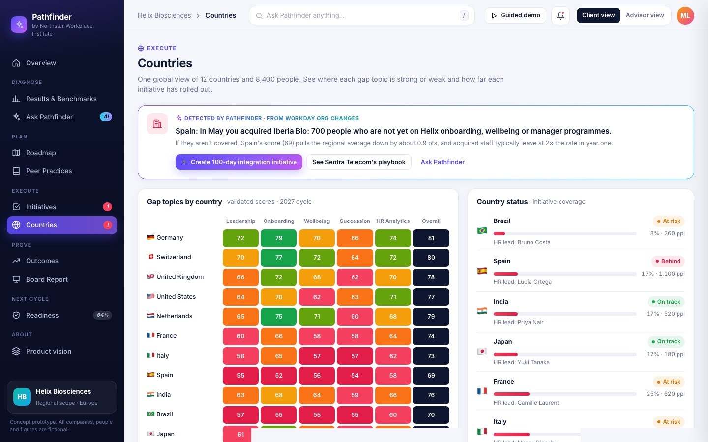</a></td>
<td><a href="https://aayushm1.github.io/hr-roadmap-copilot/#/outcomes">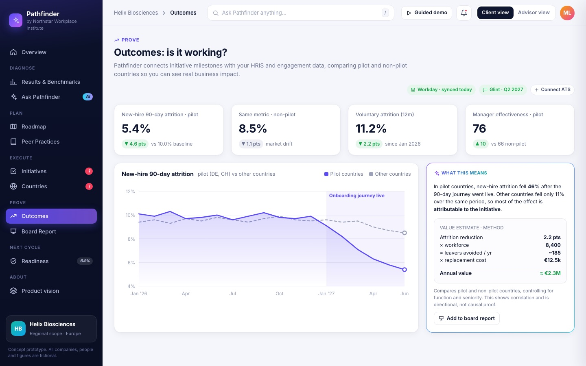</a></td>
</tr>
<tr>
<td><b>Countries.</b> A heatmap of gap topics across 12 countries. Using HR-system data, Pathfinder spots that 700 employees from a recent acquisition aren't covered by any programme, and creates a 100-day fix in one click.</td>
<td><b>Outcomes.</b> Pilot vs non-pilot comparison from HR and engagement data: new-hire attrition −46%, eNPS +9. A transparent calculation shows ≈ €2.3M a year in avoided cost.</td>
</tr>
<tr>
<td><a href="https://aayushm1.github.io/hr-roadmap-copilot/?report=1#/report">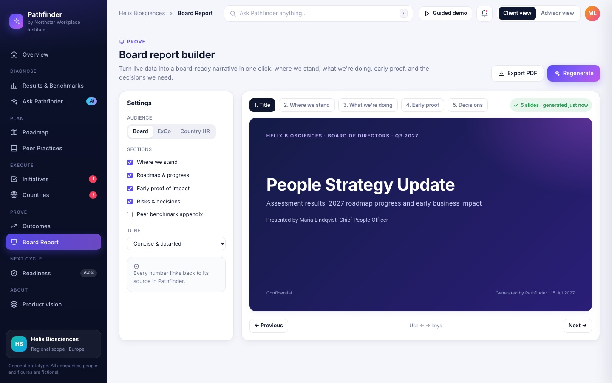</a></td>
<td><a href="https://aayushm1.github.io/hr-roadmap-copilot/#/readiness">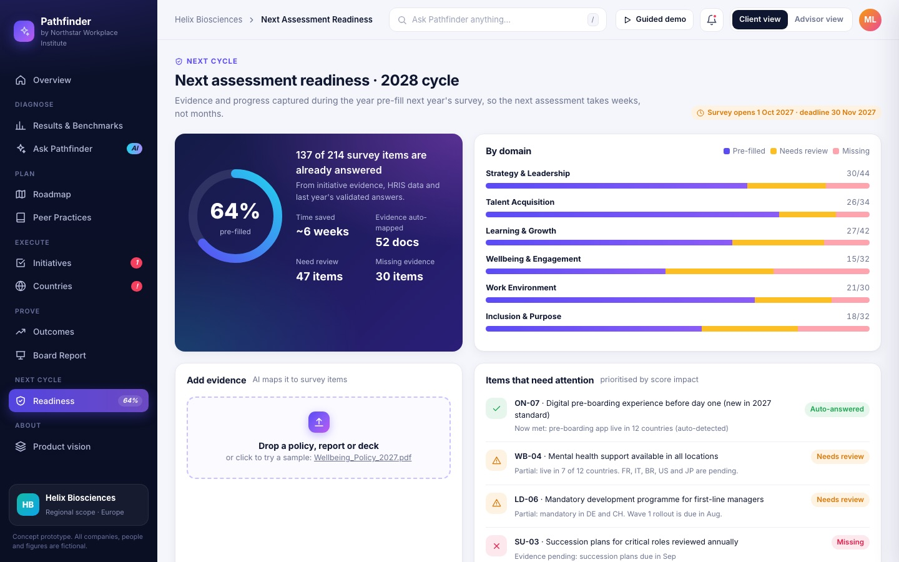</a></td>
</tr>
<tr>
<td><b>Board report.</b> Builds 5 board slides from live data in about 10 seconds: where we stand, what we're doing, early proof, and the decisions we need. Exports to PDF.</td>
<td><b>Next assessment readiness.</b> 137 of 214 survey items are already pre-filled from evidence gathered during the year. Drop in a document and the AI maps it to survey items with a confidence score.</td>
</tr>
<tr>
<td><a href="https://aayushm1.github.io/hr-roadmap-copilot/#/results">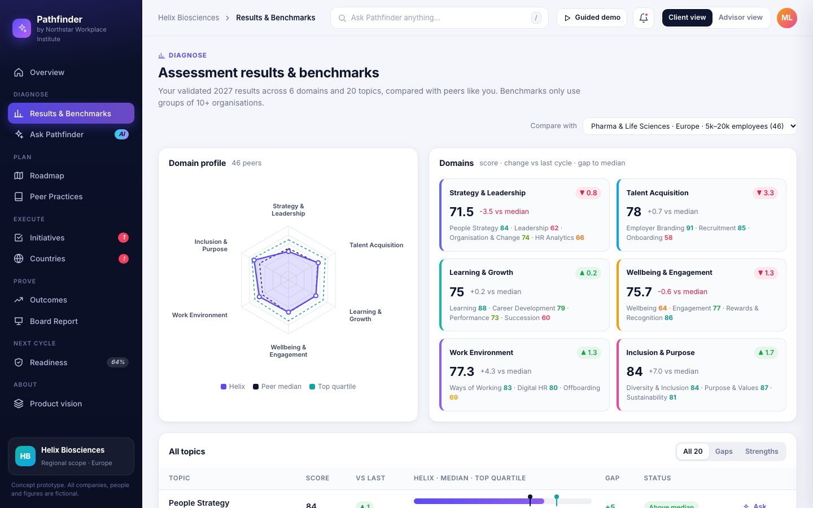</a></td>
<td><a href="https://aayushm1.github.io/hr-roadmap-copilot/#/advisor">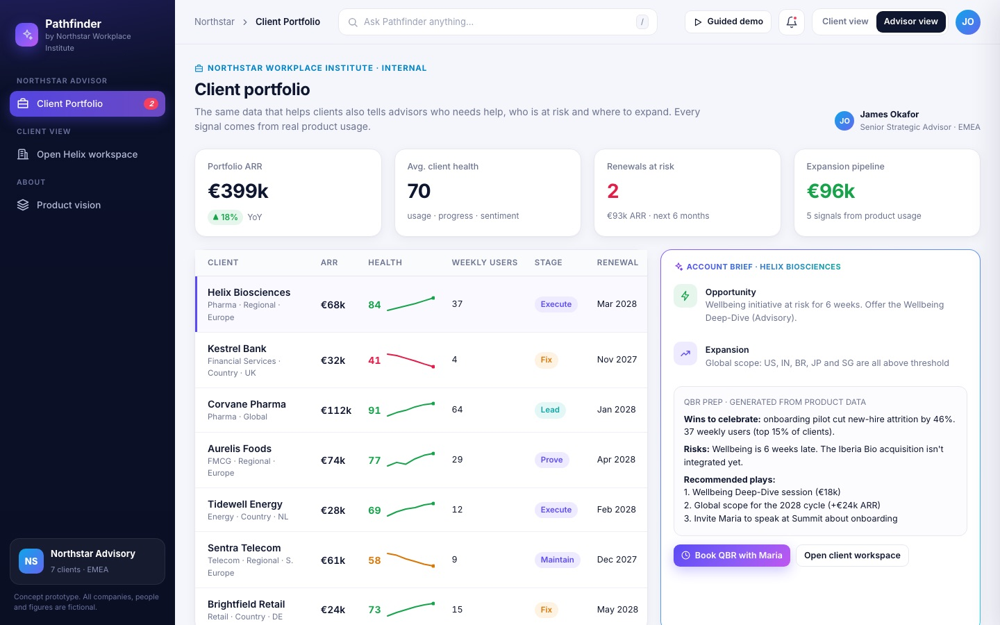</a></td>
</tr>
<tr>
<td><b>Results & benchmarks.</b> 6 domains and 20 topics vs a switchable peer group (4 benchmark sets), with gap and strength filters.</td>
<td><b>Advisor console (provider side).</b> Client health from real usage, churn signals, expansion plays, and an auto-generated account brief.</td>
</tr>
</table>

**Every screen:** Overview · Results & Benchmarks · Ask Pathfinder · Roadmap · Peer Practices · Initiatives (with drawer) · Countries · Outcomes · Board Report · Readiness · Advisor console · Product vision, plus a **13-step guided demo**.

## 5. Key product decisions

| Decision | Why |
|---|---|
| **Grounded, cited AI, never free-form** | In a business that sells credibility, a confident wrong answer costs more than a missing one. Answers come only from validated results, the evidence vault and aggregated benchmarks, and every claim cites the survey item behind it. |
| **Recommend, don't automate** | Pathfinder suggests, ranks and drafts. HR approves. Accountability stays with the client, and advisors stay in the loop. |
| **The next assessment is built into the workflow** | Evidence captured while executing initiatives flows straight into next year's survey. This creates the habit loop: users have a reason to log in every month, not once a year. |
| **Prove it in euros, with the method shown** | The CFO decides renewals. Outcomes compare pilot and non-pilot countries, show the calculation, and label it as correlation. |
| **Advisory gets leads, not competition** | Stuck initiatives and repeated questions become qualified advisory leads, so the copilot grows the services business instead of eating it. |
| **Privacy by design** | Peer data is only shown for groups of 10+ organisations. Employee data is only shown as aggregates of 20+ people. No company can be identified. |
| **One product, two personas** | The same data powers the client workspace and the provider's advisor console. Value to the client becomes visible to the business. |

## 6. Business model

| Tier | For | Includes |
|---|---|---|
| **Assess** | Today's programme | Survey and validation, employer-brand kit, results report |
| **Assess + Pathfinder** ⭐ | Most clients | Ask your results (AI), AI roadmap and tracker, board reports, pre-filled next assessment |
| **Enterprise** | Global groups | Multi-country workspace, HR-system and engagement integrations, outcome analytics, advisory hours |

**New revenue it unlocks:** a premium tier, advisory leads, scope upgrades (country → regional → global), outcome-analytics and ESG/CSRD reporting add-ons, and in the long run benchmark data products built on *which interventions actually work*.

## 7. Success metrics

| Type | Metric | Target |
|---|---|---|
| ⭐ **North star** | Monthly active client accounts outside assessment season | 60% |
| Retention | Gross revenue retention | 88% → 94% |
| Expansion | Net revenue retention (scope upgrades, add-ons) | → 112% |
| Client value | Avg. score uplift, copilot users vs non-users | +2.5 pts |
| Efficiency | Survey completion time / audit hours per client | −40% / −30% |
| Guardrail | Share of AI answers with valid citations | 100% |
| Guardrail | AI answers flagged as wrong by users | < 2% |

## 8. Rollout plan

| Phase | Scope | Timing | Exit criteria |
|---|---|---|---|
| **1 · MVP** | Ask your results + roadmap generator on existing assessment data | 1 quarter | 40% of pilot clients active monthly outside the season |
| **2 · Execute & prove** | Initiative tracker, countries, board reports, pre-filled survey | +2 quarters | Survey completion time −30% for users |
| **3 · Platform** | HR-system integrations, outcome analytics, advisor console, partner marketplace | +2 quarters | Measurable renewal-rate lift vs control |

## 9. Risks and mitigations

| Risk | Mitigation |
|---|---|
| **Confidentiality of peer data** | Groups of 10+ only, aggregated, no company can be identified |
| **AI accuracy and trust** | Retrieval from validated data only, mandatory citations, a human approves every change, and an answer-feedback loop |
| **Cannibalising advisory** | The copilot produces leads for advisors and gives them better briefs |
| **Adoption by busy HR teams** | Lead with the board report and survey pre-fill, which save real hours from week one |
| **Over-claiming impact** | Pilot vs control design, the method shown on screen, and explicit "correlation, not causation" labels |

## 10. Try it yourself

| Try this | Link |
|---|---|
| The full guided demo (13 steps) | [`?tour=1`](https://aayushm1.github.io/hr-roadmap-copilot/?tour=1) |
| Ask the AI why Onboarding dropped | [`#/copilot?ask=…`](https://aayushm1.github.io/hr-roadmap-copilot/?ask=Why%20did%20our%20Onboarding%20score%20drop%3F#/copilot) |
| Drag **Cost discipline** to 100 and watch quick wins move up | [Roadmap](https://aayushm1.github.io/hr-roadmap-copilot/#/roadmap) |
| Click **Create 100-day integration initiative**, then check the new projected score | [Countries](https://aayushm1.github.io/hr-roadmap-copilot/#/countries) |
| Open **Wellbeing Framework 2.0** → **Draft escalation to CFO** | [Initiatives](https://aayushm1.github.io/hr-roadmap-copilot/#/initiatives) |
| Switch to the provider's side | [Advisor view](https://aayushm1.github.io/hr-roadmap-copilot/#/advisor) |

Other questions to ask the AI: *"Summarise our position for my CEO"* · *"Which country is lagging and why?"* · *"How can we de-risk the wellbeing initiative?"* · *"Is the roadmap actually working?"* · *"What if we deliver the whole roadmap?"*

## 11. How it's built

A static single-page app with **zero dependencies and no build step**. It's hand-written HTML/CSS/JS with a custom SVG chart library, and is deployable anywhere (here, GitHub Pages).

```
index.html              app shell
assets/css/styles.css   design system: tokens, components, layout, print styles
assets/js/data.js       all fictional data: scores, initiatives, countries, peers, outcomes
assets/js/charts.js     dependency-free SVG charts (radar, line, matrix, ring, bars) + icon set
assets/js/app.js        state, hash router, layout, drawer/modal/toast, deep links
assets/js/views.js      every screen
assets/js/copilot.js    the grounded AI analyst (intent routing, streaming, cited blocks)
assets/js/tour.js       13-step guided demo with spotlight
docs/screenshots/       README images
```

**In the prototype, AI answers are scripted** so the demo is reliable. In production, the same interface would sit on top of retrieval-augmented generation:

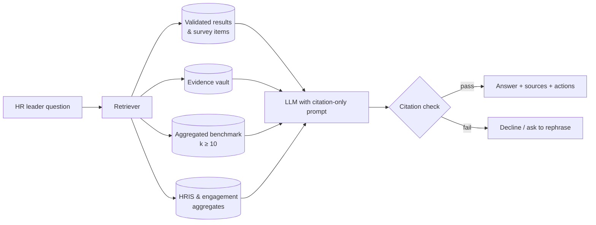

### Run locally

```bash
git clone https://github.com/aayushm1/hr-roadmap-copilot.git
cd hr-roadmap-copilot
npx serve .
```

Or just open `index.html` in a browser.

---

<div align="center">

Built by **[Aayush Mehan](https://aayushm1.github.io/)**: product thinking, PRD, design and prototype.
<br><sub>Concept prototype · fictional data · not affiliated with any real company</sub>

</div>
